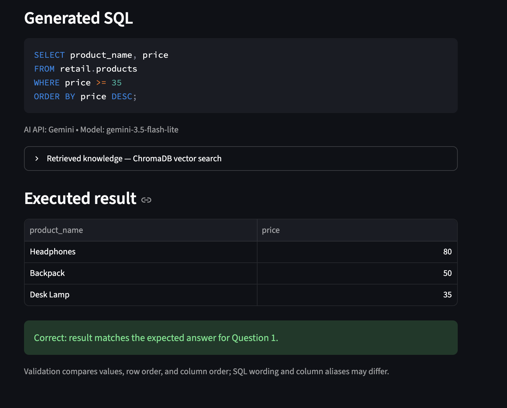

# Retail SQL Quiz

A 20-point SQL quiz built with Python, Streamlit, Supabase PostgreSQL,
and Supabase Auth, extended with ChromaDB retrieval and Gemini Text-to-SQL.

## Live quiz

https://retail-sql-quiz-pyjdd8g4py9fnrt7khvybp.streamlit.app/

## GitHub Actions

[](https://github.com/qurbanovkenan77-tech/retail-sql-quiz/actions/workflows/database-checks.yml)

The Database checks workflow connects to the live database using
GitHub Secrets. It runs on pushes to main and can also be started manually.

## How to use the quiz

1. Open the live quiz.
2. Select Create account and register with an email and password.
3. If email confirmation is requested, confirm your email and return
   to the quiz to sign in.
4. Choose a question.
5. Review the database tables and columns.
6. Enter a SELECT query and click Run SQL.
7. Compare the returned table with the expected result in the hint.
8. Click Save answer to store your SQL.
9. Sign out and sign back in to retrieve your saved answers.

Signed-out users cannot run queries, save answers, or load saved answers.
Each user has their own saved answers.

The AI assistant automatically validates its executed result against the
selected question. The app does not assign course grades. Equivalent supported SQL queries are acceptable.
Answers are assessed by their results, not exact SQL text.

## Quiz questions

| Question | Topic | Points |
|---|---|---:|
| 1 | Filter and sort products by price | 4 |
| 2 | Count customers by city | 4 |
| 3 | Join completed orders to customers | 4 |
| 4 | Find customers with no orders | 4 |
| 5 | Calculate spending using joins, SUM, and HAVING | 4 |
| **Total** | | **20** |

Every question includes a hint, example SQL, and expected result table.

## Dataset

The database contains fictional retail data:

| Table | Rows | Purpose |
|---|---:|---|
| retail.customers | 6 | Customer names and cities |
| retail.products | 6 | Products, categories, and prices |
| retail.orders | 8 | Customers' orders and order status |
| retail.order_items | 12 | Products, quantities, and prices per order |

Orders link to customers through customer_id.
Order items link to orders through order_id and products through product_id.

For spending calculations, use order_items.unit_price multiplied by
quantity. Exclude cancelled orders when the question requests
completed orders.

## How the system works

- Streamlit hosts the user interface and runs the Python backend.
- Supabase Auth handles account creation and password sign-in.
- The backend verifies the access token with Supabase before loading,
  saving, or executing quiz answers.
- Psycopg connects over the network through the Supabase Session pooler.
- Database connections enforce sslmode=require.
- Student SQL uses the restricted quiz_taker database account.
- Saving and logging use a separate quiz_app database account.

Database passwords stay on the server and are not supplied to quiz takers.

## Security and extra credit

### Parameterized application queries

Saved answers, audit entries, user IDs, and transaction identity settings
use Psycopg parameters rather than f-string SQL.

Student-authored SQL is intentionally executed as SQL. It is parsed and
restricted before execution, then run with restricted credentials in a
read-only transaction.

### Audit log

quiz_private.audit_log records the authenticated user's ID, question,
action, SQL text, success status, result row count when applicable,
error message when applicable, and timestamp.

Successful saves and their audit entries share one transaction.
Query attempts that pass basic input validation are logged, including
SQL validation failures and database query errors.

### Audit integrity

quiz_taker has no access to the private schema.
quiz_app can insert audit entries but cannot update or delete them.

The automated checks attempt UPDATE and DELETE operations as both roles
and require PostgreSQL to reject them. These checks disable the
connection's read-only default so they test database permissions directly.
They also verify that quiz_taker lacks TRUNCATE permission.

Database administrators retain administrative access to the log.

### Saved-answer isolation

Row Level Security protects saved answers. The backend sets a
transaction-local user ID obtained from the verified Auth token.
Policies require saved-answer rows and new audit entries to match it.

The quiz_app credentials are trusted backend credentials. They are never
used to execute student SQL.

### Query limits

The runner permits one SELECT statement against the four retail tables.
It restricts functions and data types, blocks modifying statements,
SELECT INTO, and row-locking queries, and applies a five-second statement
timeout and a 500-row result limit.

This is a restricted teaching SQL environment, not a general-purpose
PostgreSQL console. Some advanced SQL, including references to named
CTEs, is not supported by the current validator.

## Project files

| File | Purpose |
|---|---|
| app.py | Authentication forms and quiz interface |
| questions.py | Five questions, hints, SQL, and expected results |
| db.py | Connections, authentication checks, saving, and audit inserts |
| query_runner.py | SQL validation and restricted execution |
| check_connection.py | Basic connection and permission checks |
| ci_checks.py | Automated live-database and security checks |
| requirements.txt | Python dependencies |
| sql/01_dataset.sql | Tables and fictional dataset |
| sql/02_security.sql | Database roles, grants, and private tables |
| sql/03_read_policies.sql | Retail SELECT policies |
| sql/04_private_policies.sql | Saved-answer and audit RLS policies |
| .github/workflows/database-checks.yml | GitHub Actions workflow |

## Set up a new database

1. Create a Supabase project.
2. In Supabase SQL Editor, run the four sql/ files in numerical order.
   The policy-creation scripts are intended to run once.
3. Enable RLS on the retail tables if it is not already enabled:

```sql
ALTER TABLE retail.customers ENABLE ROW LEVEL SECURITY;
ALTER TABLE retail.products ENABLE ROW LEVEL SECURITY;
ALTER TABLE retail.orders ENABLE ROW LEVEL SECURITY;
ALTER TABLE retail.order_items ENABLE ROW LEVEL SECURITY;
```

4. Privately assign different strong passwords to quiz_taker and quiz_app.
   Do not save password-containing SQL in the repository.
5. Copy the Session pooler host, port, and project reference.
   Custom usernames are quiz_taker.PROJECT_REF and quiz_app.PROJECT_REF.
6. Obtain the Supabase project URL and publishable key.
7. Ensure email/password authentication and new-user registration
   are enabled in Supabase Auth.
8. Set the Auth Site URL to the deployed quiz URL so confirmation links
   return to the hosted application. If email confirmation is enabled,
   configure email delivery for the intended users.

## Run locally

Use Python 3.13.

```bash
git clone https://github.com/qurbanovkenan77-tech/retail-sql-quiz.git
cd retail-sql-quiz
python3 -m venv .venv
source .venv/bin/activate
python -m pip install -r requirements.txt
```

Create a local .env file with your own configuration:

```dotenv
DB_HOST=YOUR_SESSION_POOLER_HOST
DB_PORT=5432
DB_NAME=postgres
DB_SSLMODE=require
DB_TAKER_USER=quiz_taker.YOUR_PROJECT_REF
DB_TAKER_PASSWORD='YOUR_TAKER_PASSWORD'
DB_APP_USER=quiz_app.YOUR_PROJECT_REF
DB_APP_PASSWORD='YOUR_APP_PASSWORD'
SUPABASE_URL=https://YOUR_PROJECT_REF.supabase.co
SUPABASE_PUBLISHABLE_KEY=YOUR_PUBLISHABLE_KEY
```

Use the port shown for your project's Session pooler.
Both connection helpers enforce sslmode=require in code.

```bash
python check_connection.py
python ci_checks.py
python -m streamlit run app.py
```

.env, .venv/, and .streamlit/secrets.toml are excluded by .gitignore.

## GitHub Actions setup

Create these repository secrets under
Settings → Secrets and variables → Actions:

- DB_HOST
- DB_PORT
- DB_NAME
- DB_TAKER_USER
- DB_TAKER_PASSWORD
- DB_APP_USER
- DB_APP_PASSWORD

The workflow passes them as environment variables to ci_checks.py.
It does not require a committed .env file or a database administrator
password.

Checks cover:

- All five expected results against the live database.
- A total of 20 quiz points.
- Rejection of signed-out backend operations.
- Rejection of prohibited SQL.
- Denied audit UPDATE and DELETE operations.
- Denied product UPDATE operations.
- Absence of audit TRUNCATE permission for quiz_taker.

## Hosting

The quiz is deployed on Streamlit Community Cloud from main, with
app.py as the entry point and Python 3.13.

In Streamlit Advanced settings, configure the same settings as .env
as root-level TOML secrets. Quote each value. Include the Supabase URL
and publishable key as well as both database accounts.

GitHub Actions secrets and Streamlit secrets are separate configurations.

## Verification

The live-database checks passed locally and in GitHub Actions.
Manual checks confirmed sign-in, SQL execution, answer saving,
saved-answer persistence after signing out and back in, and audit entries.
Run and Save were also tested on the deployed website.

## RAG extension (Week 8)

### Architecture and AI API

Natural-language question → local TF-IDF vector → ChromaDB cosine vector
search (top 4 documents) → retrieved context plus question → Gemini API →
generated PostgreSQL SELECT → optional automatic execution → result validation.

The application reuses the Week 7 hosted PostgreSQL database and sign-in.
`rag.py` builds a ChromaDB **in-memory vector database** in the deployed app
process. It stores seven knowledge documents: database schema, business rules,
and five example question/SQL pairs. Scikit-learn converts documents and user
questions into TF-IDF vectors. Chroma's `collection.query(query_embeddings=...)`
performs actual vector retrieval; its returned documents form the API context.
The app displays retrieved document IDs/titles, text, and cosine distances.
These are lexical vectors, not pretrained semantic embeddings; vocabulary
overlap affects retrieval. No embedding model download or separate vector
server is needed. The static index is shared; user questions and answers are
not stored in the shared index. It rebuilds after app restart.

Gemini is called through Google's `generateContent` REST endpoint with the key
in the `x-goog-api-key` header. The default model is `gemini-flash-latest`;
`GEMINI_MODEL` can select another available Gemini text model. There is no
fallback that returns a stored SQL answer when the AI API fails. Retrieved
examples may include the selected question's solution; few-shot examples are
part of the knowledge corpus. The generated SQL still comes from the API.

Only the question and retrieved educational knowledge are sent to Gemini.
Database passwords, Supabase tokens, saved answers, and result rows are not
included in that request. API usage is subject to the provider's quotas and pricing.

### Run locally

Reuse your existing `.env` database and Supabase settings from the setup above.
Add these local settings (replace the placeholder privately):

```dotenv
GEMINI_API_KEY="your_private_key_here"
GEMINI_MODEL="gemini-flash-latest"
```

```bash
python -m pip install -r requirements.txt
python rag_checks.py
python -m streamlit run app.py
```

Sign in, choose a quiz question, and scroll to **AI SQL assistant**. The
plain-English input starts with that quiz question; you can also rephrase it.
Leave **Automatically run generated SQL and validate the result** checked,
then click **Generate SQL**. The app shows generated SQL, retrieved knowledge,
the executed result table, and whether it matches the selected quiz answer.
Turn the checkbox off to generate SQL without executing it. Copy generated
SQL into the existing quiz editor if you want to edit or save it.

### Deploy the extension

Push the updated source and requirements to the same repository. In the
existing Streamlit app's Secrets settings, add these **root-level TOML** entries
alongside the existing database and Supabase secrets:

```toml
GEMINI_API_KEY = "your_private_key_here"
GEMINI_MODEL = "gemini-flash-latest"
```

Save the secrets and allow the app to restart/redeploy. Never commit the actual
key or secrets file. Gemini credentials are not required for offline CI tests;
the existing live database CI still uses GitHub Secrets. Streamlit may put
inactive apps to sleep; use the wake-up button and wait for it to restart.

### Automatic execution and validation (extra credit)

Generated SQL uses the existing `run_query` function. Authentication, SQL AST
validation, allowed-table/function checks, the restricted `quiz_taker` role,
a read-only transaction, a 5-second statement timeout and 500-row result limit
apply. Executions use the existing audit logging. Generation alone is not
added to the database audit log.

`result_validation.py` compares returned cell values with the selected
question's stored expected result. It handles decimal amounts and ISO dates,
allows different column aliases, and checks row counts and row/column order
(all five prompts specify ordering). SQL strings are never compared. If the
natural-language input asks a different question, the selected quiz's expected
result may not apply; the UI states which question is used for comparison.
Invalid generated SQL is displayed with its execution error and is not marked
correct. The app does not automatically repair failed SQL.

### Checks and screenshot evidence

`python rag_checks.py` tests real Chroma retrieval for all five quiz questions,
checks that retrieved documents reach the API request, checks signed-out
generation and quota errors, and exercises result comparison. The Gemini
response is mocked in these offline checks. The GitHub Actions workflow runs
them before the existing live database checks. An actual Gemini call and the
deployed UI must also be tested with private credentials.

**Submission evidence still to capture after deployment:**

1. Basic screenshot: selected question, natural-language input and generated SQL.
2. Extra credit screenshot: generated/executed SQL, result table and validation
   outcome. The retrieval expander can also be shown as evidence of vector search.

Save screenshots as `docs/screenshots/rag-basic.png` and
`docs/screenshots/rag-validation.png` and embed them here before submitting:

```markdown


```

Do not include credentials in screenshots. This section documents the new
implementation; the Week 7 verification above does not claim that the new
Gemini integration has already been tested live.
